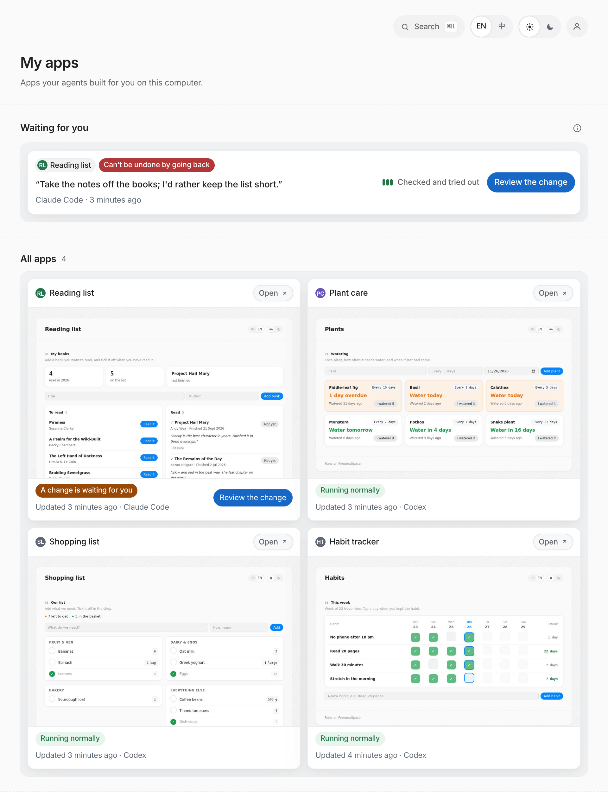
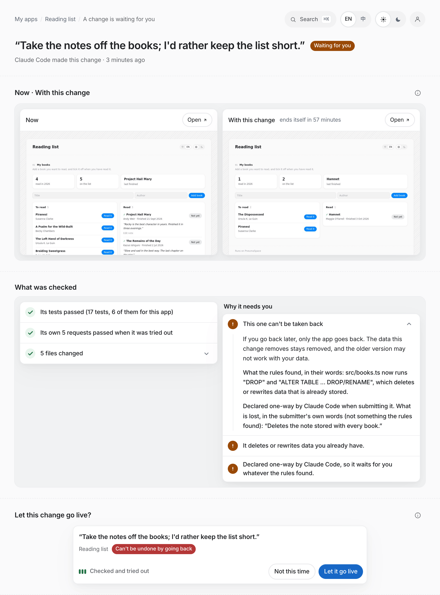
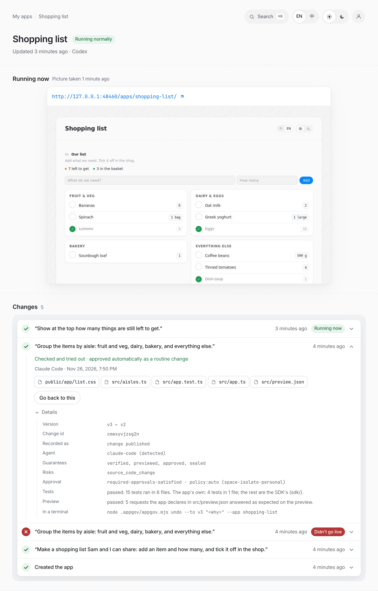
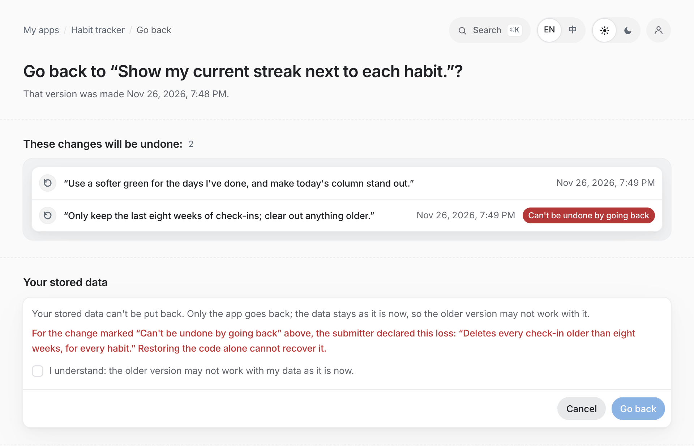

# agent-app-governance

[中文版](./README.zh-CN.md)

A coding agent builds you an app in minutes. This keeps every change after that checked, recorded and reversible, and brings you the ones that need your say.

## The problem

Claude Code or Codex can build a small app with stored data in a few minutes. Living with that app afterwards is the hard part.

- Nobody keeps track of what changed, who asked for it, or whether anything was checked before it went live.
- The next change can break the app or delete its data, and the agent does not always stop to ask.
- Going back is guesswork. The agent's session is gone, and stored data does not go back with the code.

## How it is solved

Every change goes through one service, the Host, before it is live. Whichever agent makes the change, it submits it to the Host. The Host checks it, has a rule or you approve it, publishes it and records it.

**One page for all your apps.** Each app is there with its picture, its state and its last change. What waits for you is at the top.

**A risky change waits for you. An ordinary one does not.** Before you see a change, the Host has run the app's tests, started the change as a temporary copy of the app, and made the requests the app itself declares against that copy. You see the app before and after, what was checked, and what would be lost. A change that fails a check does not go live and does not wait for you. The agent is told what was sent and what came back.

**Every version is recorded.** The record says what was asked, which agent made the change, and which checks held. It is kept in the app's own folder, so it travels with the app.

**You can go back, and you are told first what comes back.** Going back restores the code. It says so plainly when the stored data will not follow, and it asks you to confirm before it goes back past a change that cannot be undone, such as a dropped column.

## Start here

You get a page with the small apps your coding agent (Claude Code or Codex) builds for you, a record of every change, your say on the risky ones, and a way back to an earlier version. It covers the apps you create here: apps you already have cannot be imported, and it is not a backup of their data.

Choose one edition:

- **Local**: runs on your computer, in Docker. You need Docker, Node.js 24 and git. Nothing to pay. An agent's install took about two minutes with the images already built; building them the first time takes longer.
- **Cloudflare**: runs on your own Cloudflare account, so nothing runs on your computer once it is installed. You need a Cloudflare account on the Workers Paid plan (it costs money every month) with a domain in it (a domain costs a yearly fee), and Docker, Node.js 24 and Bun for the install. It installs PneumaSpace there too, and asks you for a few things only you can do in Cloudflare.

The easiest way to start: open Claude Code or Codex in the folder where it should go, and paste one sentence.

- Local: `Install the local edition of https://github.com/pandazki/agent-app-governance on this computer, following AGENTS.md in that repository.`
- Cloudflare: `Install the Cloudflare edition of https://github.com/pandazki/agent-app-governance on my Cloudflare account, following AGENTS.md in that repository.`

Your agent checks what is needed first and stops to ask you for what only you can do. To do it by hand: [the local guide](./local/README.md), [the Cloudflare guide](./cloudflare/README.md).

When it is done, you have your apps page to open in your browser (for the local edition, http://127.0.0.1:8090/ or the address your agent gives you; for the Cloudflare one, your Host's own address), and it shows the next step. Then you tell your agent what you want, for example: "Make me a new app called reading-list: a list of books I want to read, where I can add a book and tick it off when I've read it."

## What the Host does, exactly

- **One setting for how strict it is.** The Host runs in one of three modes:
  - `record`: every change is recorded and the Host publishes it. Nothing checks or approves it. A change that fails to start stays recorded but not live.
  - `personal` (the default): a change has to pass the app's tests and, unless previews are switched off, start in a preview and answer there the requests the app declares in `preview.json`. A standing rule lets ordinary changes go live; risky ones wait for you. With the default preset, a change is risky when visitors no longer have to sign in, when the app stops declaring a service that keeps stored data, or when new SQL drops or renames a table or column, drops an index, empties a table, or deletes every row. An `UPDATE` that changes stored rows is not caught.
  - `review-all`: the same checks, and you decide every change after the app is created. Creating an app never waits for you.

  Which change counts as risky is set in a preset file, not in code.
- **Every change recorded.** Each version is kept in the app's folder with what was asked, which agent made it, and which guarantees held: checked, previewed, approved, unchanged since the check. `history` says how many of the tests were the app's own, and how many of its own requests the preview answered as expected. A version that was only recorded says so. Copy the folder to another machine and its source and history go with it; the app's stored data does not.
- **Undo, with its limits stated.** Undo goes back one version at a time along the app's own line of versions, or straight to an earlier one on that line. It puts back the code. Stored data stays as it is, unless you set up the optional data snapshots for apps on PostgreSQL; they are off by default, and `status` says so.
- **One-way changes.** A one-way change is one that putting the old code back cannot undo, such as dropping a column. Going back past one needs your confirmation, in every mode. The preset marks such changes in `personal` and `review-all`. The agent can also mark one itself in any mode, by submitting with `--one-way "<what is lost>"`. In `record` mode that only marks the version. In `personal` and `review-all` the change then waits for you, with the agent's words shown as its own, even when the rules found nothing. The preset sets the least a change needs, and the agent can only raise it.
- **Taking an app down, and clearing it.** A taken-down app stops serving and keeps its data, and you can bring it back. Clearing makes the Host forget the app and its history, after you type the app's name. In the local edition it also deletes the stored data. In the Cloudflare edition the data stays on PneumaSpace until its owner purges it there. The Host never says an app is gone from PneumaSpace while PneumaSpace still lists it.
- **Any agent, or a product that starts one.** An agent edits the app in place and submits with a small CLI kept in the app's folder. In the local edition a program can also have the Host start Claude Code or Codex itself. Both write to the same history.

## Editions

| Edition | State | Where the apps run |
| --- | --- | --- |
| [local](./local/README.md) | Runs | Your machine: one `docker compose up` starts PneumaSpace and the Host, on loopback ports |
| [cloudflare](./cloudflare/README.md) | Runs, `personal` mode only, the apps page behind a sign-in | Cloudflare: the Host in a Container behind a Worker, each app's record in R2, the apps on a PneumaSpace deployment on Cloudflare. The owner signs in; agents use tokens the owner creates |

The two editions share the Host's code and differ in where it runs and in the app template, because PneumaSpace's two planes have different app contracts. Each guide lists what its edition needs and its own limits.

## Limits

- It covers new apps created here from a template. Nothing imports an existing app or its data.
- It is built for one person. The local edition assumes one trusted machine and does not authenticate the owner: approving needs a terminal, or a link the Host prints in its log. That stops an honest agent from approving its own change, not another program on the same machine. The Cloudflare edition has one owner key.
- Undo restores code. Stored data comes back only through the optional snapshot practice, and only for apps whose database is on PostgreSQL. Apps on SQLite, and files, key-value data and objects, are not covered.
- A preview starts with empty storage. It shows that a change works, not how it behaves on the data your app already holds. When a change that drops or rewrites stored data waits for you, you decide from what the Host tells you would be lost.
- In the Cloudflare edition the agent never opens the live app and never holds PneumaSpace's credentials. It learns how its change behaves from the checks in the preview.
- A scheduled job in an app is not shown by the preview, because a preview never runs its schedule. The app's own tests show the job's logic.
- The preset's rules for SQL are text patterns: they stop a `DROP` written in a string that never runs, and miss a deletion built from variables.
- The rules read only SQL text and the app's manifest. A change that deletes or rewrites files, key-value data or objects looks like an ordinary code change to them; for that, the Host relies on the agent declaring it with `--one-way`. The agent instructions in every app tell it to.

## What has been run

Each entry has its date, so that you can judge how far to trust it.

- **A developer who had not used it before** (2026-11-27). Their agent connected to a Cloudflare Host with the one-time code from the apps page and released an app in two versions, through the tests, the preview requests and the standing rule. They reported two faults. Creating the app took 19 s and a change took 18 s, for an app of 2.4 MB. And the first submit was refused, because a preview needs one of the deployment's two awake slots and the first version was still awake. Both were fixed the same day ([#23](https://github.com/pandazki/agent-app-governance/pull/23), [#24](https://github.com/pandazki/agent-app-governance/pull/24)), and the numbers below are from after the fix.
- **Agents with no prior context.** Three rounds of Codex sessions started from an empty folder with only what this repository says. Two rounds were on the Cloudflare edition (2026-11-25, four sessions and then seven; reports in [#4](https://github.com/pandazki/agent-app-governance/issues/4) and [#6](https://github.com/pandazki/agent-app-governance/issues/6)). The third was on getting started (2026-11-26, [#14](https://github.com/pandazki/agent-app-governance/issues/14)): one session installed the local edition from the sentence under "Start here" on a machine whose default ports were taken, a second made a working app from the first one's hand-off, and a third connected to a Cloudflare Host from the apps page and released two versions of an app. What each round found was fixed, or is stated under Limits.
- **The Cloudflare edition on a real deployment** (2026-11-25 to 27): the install and its reruns, the owner's sign-in, tokens, the apps page in a browser, ordinary and risky changes, and undo. A change whose data route was broken passed its own tests and was stopped by its preview requests. A submit that met a workspace with no free awake slot put its own app to sleep and went live. A scheduled job declared as the template says arrived while the app was asleep, woke it and ran once, and a job declared without its handler was refused before any preview. On the final code, with the starter app: create took 15 s in a new container, a change 11 s, an undo 4 s. A change to an app of 2.4 MB took 15.5 s. [The Cloudflare guide](./cloudflare/README.md#what-has-been-run) has the detail.
- **The local edition on a live stack** (macOS with colima, 2026-11-26 and 27): one-way changes approved by the owner and gone back past with PostgreSQL snapshots, then cleared with nothing left behind. A go-back that failed and left the app on its version. A clear that PneumaSpace did not finish, and the retry that did. A change with a broken route stopped by the app's own preview requests. The pictures at the top of this page are from such a stack.
- **The offline tests** on this code: `bun test` in `local/` and in `cloudflare/`.
- **Not run.** A Linux machine. More than one user. A Cloudflare install from nothing by someone new, past the Wrangler sign-in. Claude Code as the agent on this code: it ran on the earlier build this repository came from. An agent with no context that is left to write `preview.json` by itself.

## Background

This repository is a complete example, not a product. It exists to show two other projects working together with a real agent, at the size of one person.

An agent can now build a small app in minutes. So people have apps made for one job, keep them for years, and open them now and then. Wherever a product lets its users do that, the apps pile up. There are far more of them than a team would ever write by hand. They are all cut from one pattern, and at any moment most of them are idle. That raises two separate questions.

**What happens at each change?** Something has to keep what changed, what was checked and who agreed, and has to offer a way back. [pneuma-framework](https://github.com/pandazki/pneuma-framework) answers this question. How much of it you use depends on what is at stake. Where changes must be audited, you add rules and keep more in the record. Where one person builds for their own use, a plain record is enough, and so is none.

**What happens to each app over the years?** It has to cost almost nothing while nobody uses it, and open fast when somebody does. Its data has to outlast every release, and every change to the platform under it. [PneumaSpace](https://github.com/pandazki/pneuma-space) answers this question, for apps that all follow one contract.

Neither project builds an app, and neither is what a user looks at. This repository adds the part in the middle, the Host, so that you can watch the whole path work.

## Building your own product on these parts

The parts are made to sit under a product that lets its users have apps built. If you build such a product, the things in this table are yours to supply. This example holds only a small stand-in for each.

| Yours to supply | What you decide there | The stand-in here |
| --- | --- | --- |
| The place where a user opens an app | How your product shows the app's page, and what it tells the page about the user and the surroundings | A browser tab |
| Sign-in | Who the user is. Your product's own sign-in answers that | No sign-in for the owner in the local edition. One owner key in the Cloudflare edition |
| The starting point of every app | The components, the SDK and the instructions an agent builds from. Whatever your product gives to every app, it gives here | The template an app is created from, and the instructions written into each app for the agent |
| What an app may do | Which platform services your users' apps get. You leave out what you do not want to pay for or support, and you say so | The template uses a few services. This example does not restrict which services an app declares |
| The path to going live | Which changes need a person, and who that person is | The Host's three modes and its preset file. The person is the one owner |
| Who builds | Your product's own agent, or an agent the user runs | An agent the user runs submits with a small CLI. In the local edition a program can also have the Host start Claude Code or Codex |

You take two parts as they are: PneumaSpace to run the apps, and as much of pneuma-framework as your path to going live needs.

Read the example to see how the parts connect. The Host's code is in [`host/`](./host). It is written to be read and changed, not imported as a package. The steps that publish a version, check that the app answers and put the address back are there too, not in pneuma-framework.

## Built on

- [pneuma-framework](https://github.com/pandazki/pneuma-framework) provides the change history and its guarantees, the sequence of checks before a change is applied, the approval rules, the record of which version an address serves, and the adapters that start Claude Code and Codex. Its packages are not published; both editions take them from source at one pinned commit.
- [PneumaSpace](https://github.com/pandazki/pneuma-space) runs the apps: an app is a folder and a manifest, a preview is a temporary app that ends itself, and a released app refuses writes that do not name the Host that manages it. The local edition builds it from source at one pinned commit. The Cloudflare edition uses a PneumaSpace deployment on your Cloudflare account.

## License

[MIT](./LICENSE). pneuma-framework and PneumaSpace, which the images are built from, are MIT as well.
