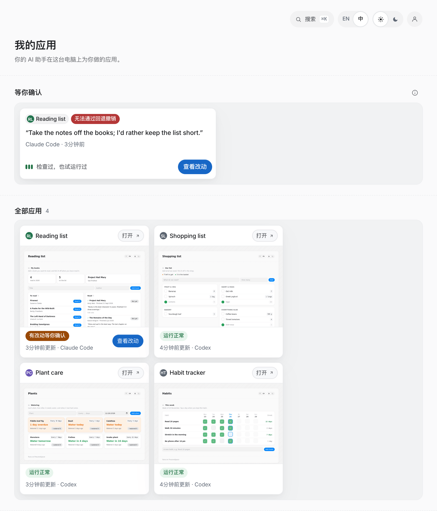
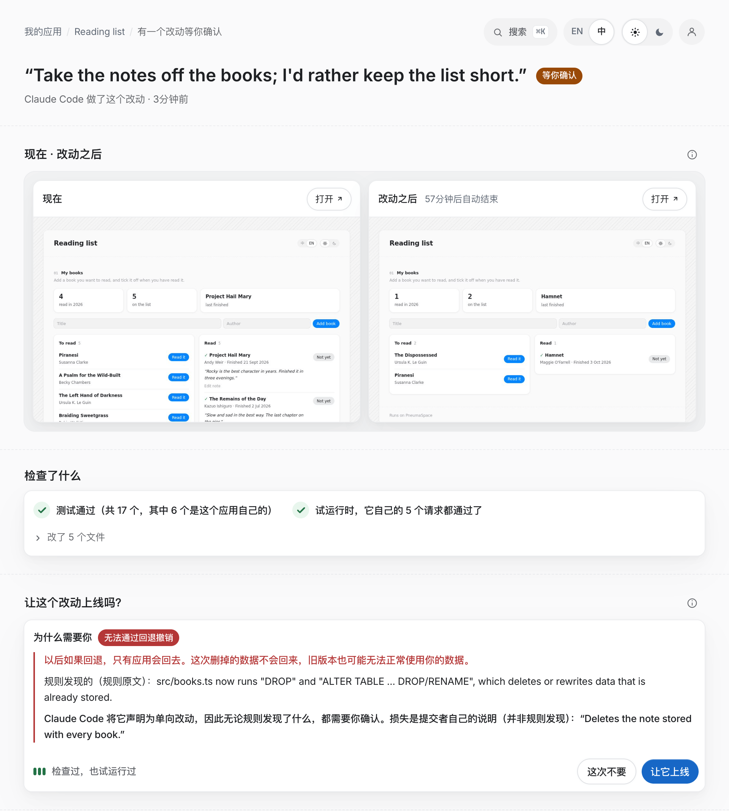
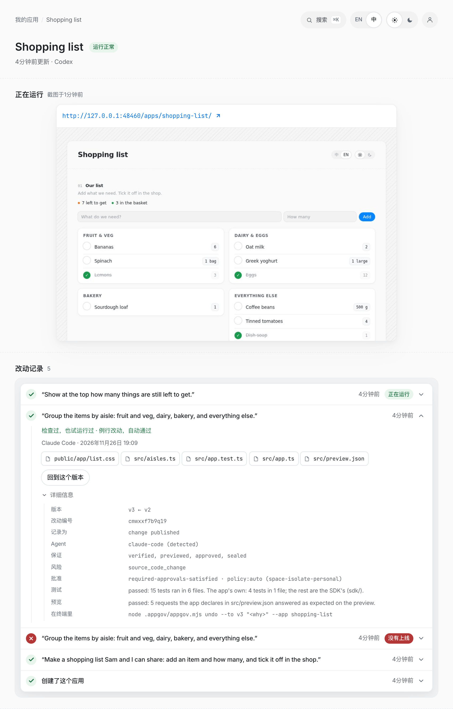
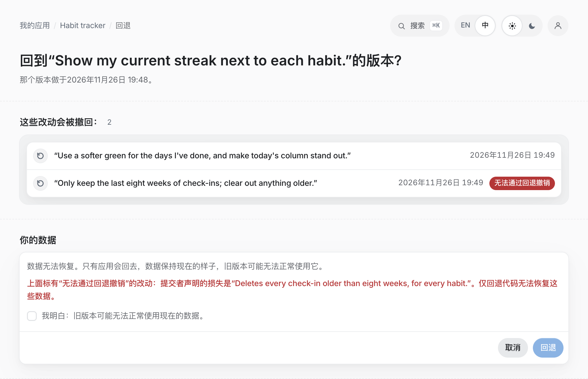

# agent-app-governance

[English](./README.md)

coding agent 几分钟就能给你做出一个应用。这个仓库管的是之后的事：每次改动都检查、记录、可以回退，需要你拿主意的改动会送到你面前。

## 问题

Claude Code 或 Codex 几分钟就能做出一个带存储数据的小应用。难的是之后怎么跟这个应用过日子。

- 没人记下改了什么、是谁要求的、上线前有没有检查过。
- 下一次改动可能把应用改坏，或者删掉它的数据，而 agent 不一定会停下来问你。
- 想回退只能靠猜。agent 的会话已经没了，存储的数据也不会跟着代码一起回去。

## 怎么解决

每次改动上线之前，都要经过一个叫 Host 的服务。不管是哪个 agent 改的，都把改动提交给 Host。Host 检查它，交给规则或你来批准，然后发布并记录。

**所有应用在一个页面上。** 每个应用都带着截图、状态和最近一次改动。等你决定的事排在最上面。

**有风险的改动等你决定，常规改动不用。** 在你看到一个改动之前，Host 已经跑过应用的测试，把改动启动成应用的一份临时副本，并对这份副本发出了应用自己声明的请求。你看到的是应用改动前后的样子、检查了什么、会失去什么。没通过检查的改动不会上线，也不会来等你。agent 会被告知发了什么、返回了什么。

**每个版本都有记录。** 记录里写着当时的要求、是哪个 agent 改的、哪些检查成立。它保存在应用自己的目录里，所以跟着应用走。

**可以回退，而且先告诉你哪些会回来。** 回退恢复的是代码。存储的数据不会跟着回去时，它会明说。要越过一个撤销不了的改动（比如删掉一列）往回退，它会先请你确认。

## 从这里开始

你会得到一个页面：上面是你的 coding agent（Claude Code 或 Codex）为你做的小应用，每次改动都有记录，有风险的改动由你说了算，也随时能回到早先的版本。它管的是在这里创建的应用：你已有的应用接不进来，它也不是这些应用数据的备份。

先选一个版本：

- **本地版**：跑在你自己的电脑上，用 Docker。需要 Docker、Node.js 24 和 git。不用花钱。镜像已经构建好时，agent 的一次安装用了大约两分钟；第一次要先构建镜像，会更久。
- **Cloudflare 版**：跑在你自己的 Cloudflare 账号上，装好之后你的电脑上什么都不用跑。需要一个开通 Workers Paid 套餐的 Cloudflare 账号（每月收费），账号里要有一个域名（域名每年收费）；安装时还需要 Docker、Node.js 24 和 Bun。它会顺带在那里装好 PneumaSpace，中间有几步只有你能在 Cloudflare 上做，到时会问你。

最省事的开始方式：在想放它的文件夹里打开 Claude Code 或 Codex，粘贴一句话。

- 本地版：`Install the local edition of https://github.com/pandazki/agent-app-governance on this computer, following AGENTS.md in that repository.`
- Cloudflare 版：`Install the Cloudflare edition of https://github.com/pandazki/agent-app-governance on my Cloudflare account, following AGENTS.md in that repository.`

你的 agent 会先检查需要的东西，遇到只有你能做的事会停下来问你。想自己动手，就看[本地版指南](./local/README.zh-CN.md)或 [Cloudflare 版指南](./cloudflare/README.zh-CN.md)。

装好之后，你会有一个在浏览器里打开的应用页面（本地版是 http://127.0.0.1:8090/ 或 agent 告诉你的地址，Cloudflare 版是你的 Host 自己的地址），页面会告诉你下一步做什么。然后直接告诉你的 agent 你想要什么，比如：“帮我做一个叫 reading-list 的新应用：记下我想读的书，可以添加书，读完了可以打勾。”

## Host 具体做什么

- **一个设置决定管得多严。** Host 以三种模式之一运行：
  - `record`：每次改动都记录下来，由 Host 发布，没有任何检查或批准。启动不起来的改动仍然记录在案，只是没有上线。
  - `personal`（默认）：改动要通过应用自己的测试；除非关掉了预览，还要在预览里启动成功，并按预期回答应用在 `preview.json` 里声明的请求。常规改动由常设规则放行；有风险的改动等你决定。按默认预设，有风险指的是访客不再需要登录，应用不再声明某项保存数据的服务，或者新加的 SQL 删除或重命名表或列、删除索引、清空一张表，或删除所有行。改写已存数据行的 `UPDATE` 不会被拦下。
  - `review-all`：同样的检查，应用创建之后的每次改动都由你决定。创建应用本身不用等你。

  什么改动算有风险，写在一个预设文件里，不写在代码里。
- **每次改动都有记录。** 每个版本都保存在应用目录里，带着当时的要求、是哪个 agent 改的、哪些保证成立：检查过、预览过、批准过、检查之后没再变过。`history` 会写明跑过的测试里有几个是应用自己的，以及预览按预期回答了应用自己的几个请求。只记录、没检查的版本也会如实写明。把目录拷到另一台机器，源码和历史跟着走，应用存储的数据不会跟着走。
- **撤销，并写明它的限度。** 撤销沿着应用自己的版本线往回走，一次回一个版本，也可以直接回到这条线上更早的某个版本。它放回的是代码。存储的数据保持原样；只有为 PostgreSQL 上的应用开启可选的数据快照，数据才能一起回去。快照默认关闭，`status` 会如实显示。
- **单向改动。** 单向改动是指放回旧代码也撤销不了的改动，比如删掉一列。越过它往回退，在任何模式下都需要你确认。在 `personal` 和 `review-all` 模式下由预设标出这类改动。不管哪种模式，agent 也可以在提交时加 `--one-way "<会丢失什么>"` 自己标出。在 `record` 模式下，这只是给版本做个标记。在 `personal` 和 `review-all` 模式下，这个改动会因此等你决定，agent 的原话会作为它自己的声明给你看，即使规则什么也没发现。预设定下一个改动至少要过哪一关，agent 只能往上加，不能往下减。
- **收起和清除。** 收起的应用不再提供服务，数据保留，之后可以恢复。清除要你输入应用的名字，之后 Host 不再记得这个应用和它的历史。本地版会同时删掉存储的数据；Cloudflare 版的数据留在 PneumaSpace 上，直到它的主人在那里彻底删除。只要 PneumaSpace 还列着这个应用，Host 就不会说它已经从 PneumaSpace 上消失。
- **任何 agent，或者自己启动 agent 的产品。** agent 在原地改应用，再用应用目录里的一个小 CLI 提交。在本地版里，也可以由程序让 Host 自己启动 Claude Code 或 Codex。两种方式写进同一份历史。

## 版本

| 版本 | 状态 | 应用跑在哪里 |
| --- | --- | --- |
| [本地版](./local/README.zh-CN.md) | 能跑 | 你的机器：一条 `docker compose up` 启动 PneumaSpace 和 Host，只监听回环端口 |
| [Cloudflare 版](./cloudflare/README.zh-CN.md) | 能跑，只有 `personal` 模式，应用页面要先登录 | Cloudflare：Host 跑在 Worker 后面的 Container 里，每个应用的记录在 R2，应用跑在部署于 Cloudflare 的 PneumaSpace 上。主人要登录；agent 用主人创建的令牌 |

两个版本共用 Host 的代码，不同的是它跑在哪里，以及应用模板，因为 PneumaSpace 的两个运行面有各自的应用契约。每个版本需要什么、有哪些自己的限度，见各自的指南。

## 限度

- 它管的是在这里用模板新建的应用，没有导入已有应用或其数据的办法。
- 它是给一个人用的。本地版假定只用在一台你信任的机器上，主人没有经过认证：批准需要一个终端，或者 Host 打印在日志里的一个链接。这能挡住诚实的 agent 批准自己的改动，挡不住同一台机器上的其他程序。Cloudflare 版只有一把主人密钥。
- 撤销恢复的是代码。存储的数据只有通过可选的快照做法才能回来，而且只适用于数据库在 PostgreSQL 上的应用。SQLite 上的应用，以及文件、键值数据和对象，都不在范围内。
- 预览的存储一开始是空的。它能说明一个改动能用，说明不了这个改动在应用已有的数据上表现如何。一个删除或改写存储数据的改动在等你决定时，你依据的是 Host 告诉你会失去什么。
- 在 Cloudflare 版里，agent 不会打开线上的应用，也拿不到 PneumaSpace 的凭证。它是从预览里的检查得知自己的改动表现如何的。
- 应用里的定时任务在预览里看不出来，因为预览从不按计划触发任务。任务的逻辑要靠应用自己的测试来说明。
- 预设里针对 SQL 的规则是文本匹配：写在字符串里、根本不会执行的 `DROP` 也会被拦下，用变量拼出来的删除却拦不住。
- 规则只读 SQL 文本和应用的清单。一个删除或改写文件、键值数据或对象的改动，在规则看来就是普通的代码改动；这种情况下 Host 依靠 agent 用 `--one-way` 自己声明。每个应用里给 agent 的说明都要求它这样做。

## 跑过什么

每一条都带日期，方便你判断能信到什么程度。

- **一位第一次用它的开发者**（2026-11-27）。他的 agent 用应用页面给出的一次性代码连接到一个 Cloudflare 上的 Host，发布了一个应用的两个版本，经过了测试、预览请求和常设规则。他报告了两个问题。对一个 2.4 MB 的应用，创建用了 19 秒，一次改动用了 18 秒。另外第一次提交被拒绝了，因为预览要占用部署里两个唤醒名额中的一个，而第一个版本当时还醒着。两个问题当天都修掉了（[#23](https://github.com/pandazki/agent-app-governance/pull/23)、[#24](https://github.com/pandazki/agent-app-governance/pull/24)），下面的数字是修完之后的。
- **没有任何上下文的 agent。** 三轮 Codex 会话，都从空目录开始，只能读这个仓库里写的东西。前两轮在 Cloudflare 版上（2026-11-25，先四个会话，后七个；报告见 [#4](https://github.com/pandazki/agent-app-governance/issues/4) 和 [#6](https://github.com/pandazki/agent-app-governance/issues/6)）。第三轮试的是上手（2026-11-26，[#14](https://github.com/pandazki/agent-app-governance/issues/14)）：一个会话照“从这里开始”里的那句话，在默认端口已被占用的机器上装好了本地版；第二个会话照它的交接说明做出了一个能用的应用；第三个会话从应用页面连接到一个 Cloudflare 上的 Host，并发布了一个应用的两个版本。每一轮发现的问题要么已经修掉，要么写在了“限度”里。
- **Cloudflare 版，在真实的部署上**（2026-11-25 到 27）：安装和重跑、主人登录、令牌、浏览器里的应用页面、常规改动和有风险的改动、撤销。一个数据路由写坏了的改动通过了它自己的测试，被预览请求拦下。一次提交碰上工作空间没有空闲的唤醒名额，Host 让它自己的应用去睡，改动照常上线。一个按模板说明声明的定时任务在应用休眠时到达，把应用唤醒并运行了一次；一个声明了却没有处理文件的任务，在预览之前就被拒绝。在最终的代码上，用起步应用：创建在新容器里用了 15 秒，一次改动 11 秒，一次撤销 4 秒。对一个 2.4 MB 的应用，一次改动用了 15.5 秒。细节见 [Cloudflare 版指南](./cloudflare/README.zh-CN.md#跑过什么)。
- **本地版，在真实的栈上**（macOS 加 colima，2026-11-26 和 27）：主人批准的单向改动，带着 PostgreSQL 快照越过它们回退，然后清除，什么都没留下。一次失败的回退，应用留在原来的版本上。一次 PneumaSpace 没删完的清除，以及之后成功的重试。一个路由写坏了的改动，被应用自己的预览请求拦下。本页开头的截图就来自这样一个栈。
- **离线测试**，在这份代码上：`local/` 和 `cloudflare/` 里的 `bun test`。
- **没跑过的。** 一台 Linux 机器。多于一个用户。由一个新来的人从零完成 Cloudflare 版的安装（Wrangler 登录之后的部分）。用 Claude Code 当 agent 跑这份代码：它只在这个仓库的前身上跑过。让一个没有上下文的 agent 自己去写 `preview.json`。

## 背景

这个仓库是一个完整的示例，不是产品。它的用处是让你看到另外两个项目和真实的 agent 一起工作，规模是一个人用。

现在 agent 几分钟就能做出一个小应用。于是人们为一件具体的事让它做一个应用，一留好几年，偶尔打开一次。只要有产品让用户这么做，应用就会越积越多。它们的数量远超过任何团队手写得出来的量，都是同一个模子出来的，而且任何时刻绝大多数都闲着。这带来两个互相独立的问题。

**每次改动的时候会发生什么？** 需要有东西记下改了什么、检查过什么、谁同意的，并且留一条回去的路。[pneuma-framework](https://github.com/pandazki/pneuma-framework) 回答这个问题。用多少取决于事情有多要紧：改动需要审计的地方，就多加规则、多记一些；一个人给自己做东西，只留一份记录就够，一点不用也可以。

**每个应用在这些年里会怎样？** 没人用的时候它几乎不能花钱，有人来的时候要打开得快。它的数据要比每一次发布都活得久，底下的平台怎么变也不能丢。[PneumaSpace](https://github.com/pandazki/pneuma-space) 回答这个问题，前提是这些应用都遵守同一份契约。

这两个项目都不负责做应用，也都不是用户眼前看到的东西。这个仓库补上中间那一段，也就是 Host，让你能看到整条路走通。

## 在这些部件上做你自己的产品

这些部件是为了垫在一个产品下面而做的，这个产品让它的用户可以找 agent 做应用。如果你要做这样的产品，下表里的东西由你来提供。这个示例里每一项都只有一个很小的替身。

| 由你提供的 | 你在这里决定什么 | 示例里的替身 |
| --- | --- | --- |
| 用户打开应用的地方 | 你的产品怎样展示应用的页面，以及把哪些关于用户和环境的信息告诉页面 | 浏览器的一个标签页 |
| 登录 | 用户是谁。这由你的产品自己的登录来回答 | 本地版的主人不用登录。Cloudflare 版只有一把主人密钥 |
| 每个应用的起点 | agent 动手时依据的组件、SDK 和说明。你的产品想让每个应用都有的东西，就放在这里 | 创建应用用的模板，以及写进每个应用、给 agent 看的说明 |
| 应用能做什么 | 你的用户做的应用能用平台的哪些服务。不想付费或不想支持的就不提供，并且写明 | 模板用到了其中几项服务。这个示例不限制应用声明哪些服务 |
| 上线要过哪些关 | 哪些改动需要人来决定，这个人是谁 | Host 的三种模式和预设文件。这个人就是唯一的主人 |
| 谁来做 | 你的产品自带的 agent，或者用户自己运行的 agent | 用户运行的 agent 用一个小 CLI 提交。在本地版里，也可以由程序让 Host 启动 Claude Code 或 Codex |

有两样东西你可以原样拿去用：用 PneumaSpace 运行应用；pneuma-framework 则按你的上线流程需要多少就用多少。

读这个示例，是为了看清这些部件怎样接在一起。Host 的代码在 [`host/`](./host)。它是写给人读、给人改的，不是可以直接 import 的包。发布版本、确认应用有应答、把地址放回去的那几步也在这里，不在 pneuma-framework 里。

## 基于

- [pneuma-framework](https://github.com/pandazki/pneuma-framework) 提供改动历史及其保证、改动生效前的检查顺序、批准规则、某个地址正在跑哪个版本的记录，以及启动 Claude Code 和 Codex 的适配器。它的包没有发布；两个版本都从源码取，固定在一个提交。
- [PneumaSpace](https://github.com/pandazki/pneuma-space) 运行这些应用：应用是一个目录加一份清单，预览是会自己结束的临时应用，发布出去的应用会拒绝没有写明管理它的 Host 的写操作。本地版从源码构建它，固定在一个提交。Cloudflare 版用的是部署在你 Cloudflare 账号上的 PneumaSpace。

## 许可证

[MIT](./LICENSE)。构建镜像所用的 pneuma-framework 和 PneumaSpace 也是 MIT。
